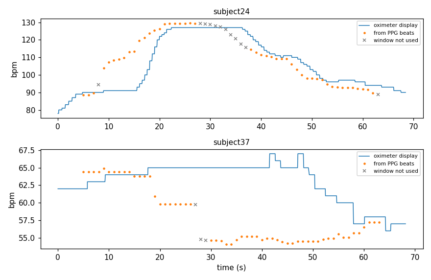

# Phase 0: a reference I can trust

Before any rPPG I needed a heart rate to compare against. UBFC-rPPG ships a contact PPG (60 Hz) and the HR the oximeter shows on its screen. I ended up trusting the first and not the second.

## Turning PPG into HR

`pulsecam/reference.py` makes one HR per 10 s window, stepping 1 s at a time. It band-passes 0.7 to 3.5 Hz, finds the beats, refines each peak with a parabola and takes 60 / median beat interval.

A window is kept only if all of these hold:

- at least 5 beats
- beat intervals vary by 15% or less (coefficient of variation)
- the beat-based HR is within 5 bpm of the spectral peak of the same window
- no gap longer than 0.3 s in the recording

The parabola is there because at 60 Hz a peak can only sit on whole samples, and that alone put the reference 3.6 bpm off at 160 bpm on synthetic data. The beat-vs-spectrum check is there because pure noise passed the interval check 65% of the time. With both checks, 0% passes.

The gap rule comes from the real files. Almost every subject has holes in its timestamps, mostly 0.1 to 0.3 s and up to 1 s in subject 23. Frames and PPG samples are one-to-one, so the video drops those frames too. That's why all my code uses per-frame timestamps and never assumes 30 fps. Subjects 25, 26 and 27 actually run at about 23 fps.

## Results on all 42 subjects

| | |
|---|---|
| videos open, frame count = PPG length | 42 / 42 |
| windows usable as reference | 2223 / 2390 (93%) |
| worst subject | subject 3, 59% usable |
| beat HR vs spectral HR | 0.79 bpm apart |
| vs oximeter screen HR, shifted 3 s | 1.74 bpm |

My target was under 1 bpm against the oximeter screen. I missed it, and I think the screen is the problem.

- It runs a few seconds late, and in subject 24 it's 5 to 8 s late.
- It moves in steps and sometimes just sits there. In subject 37 it stays at 64 while the beats drop to 55, and it catches up 30 s later.
- In subject 11, 418 readings are under 30 bpm and some are exactly 1.

The beats are where I'd put them by eye, and two separate estimates from the same PPG agree to 0.79 bpm. So the PPG reference stays. I didn't tune it to look closer to the screen, because that would just be fitting the screen's lag.

## Splits

Seed 2026, made before I opened any video (`scripts/make_splits.py`). UBFC-rPPG test: 8, 12, 14, 18, 22, 23, 27, 31, 43, 45, 47, 49. UBFC-Phys test: s4, s6, s7, s10. The checks above touch all subjects, but only the contact signals, never a camera HR.
